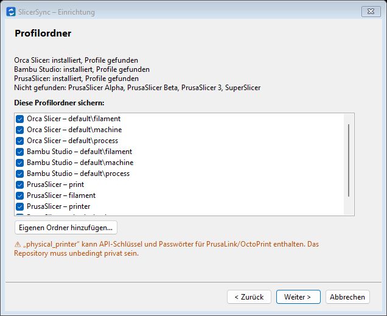
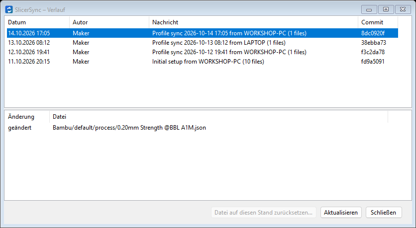
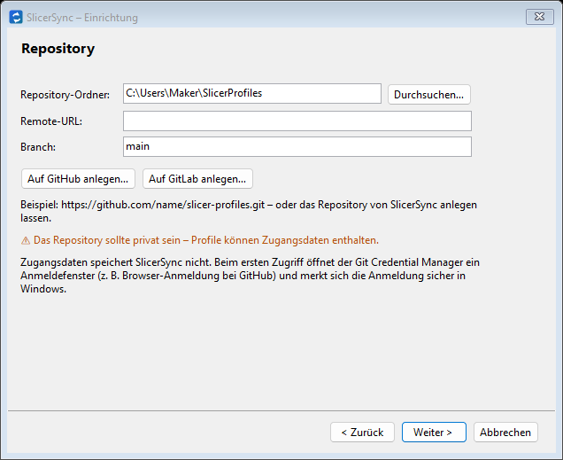
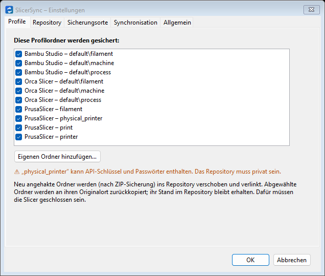
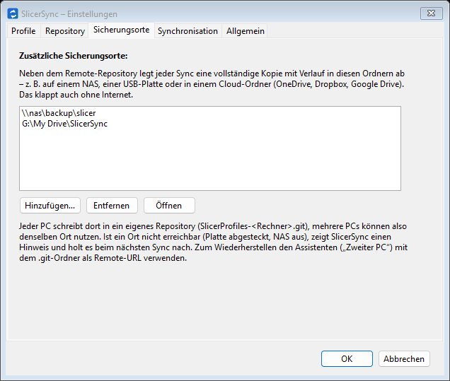
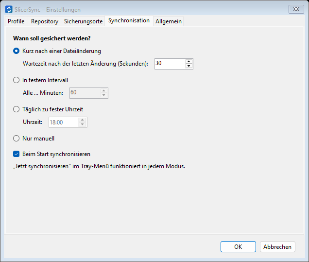

<p align="center">
  
</p>

<h1 align="center">SlicerSync</h1>

<p align="center">
  <b>Slicer-Profile automatisch mit Git sichern und zwischen PCs abgleichen – mit vollständigem Verlauf.</b><br>
  <a href="README.md">English</a> | <b>Deutsch</b>
</p>

<p align="center">
  <a href="../../releases/latest"></a>
  <a href="../../actions/workflows/ci.yml"></a>
  
  <a href="LICENSE"></a>
</p>

SlicerSync ist eine kleine Windows-App für den Infobereich der Taskleiste. Sie sichert die Drucker-, Filament- und
Prozessprofile, die du im Slicer anlegst, in ein **privates Git-Repository** (GitHub, GitLab, ein NAS …) und hält sie
zwischen deinen PCs abgeglichen. Einmal mit dem Assistenten einrichten – ohne Kommandozeile und ohne Git-Kenntnisse.

<p align="center">
  
  
</p>

## Funktionen

- **Unterstützte Slicer:** Orca Slicer, Bambu Studio, PrusaSlicer (auch 2.x Alpha/Beta und PrusaSlicer 3),
  SuperSlicer – dazu **jedes andere Programm** als eigener Ordner (Cura, Creality Print, ElegooSlicer, …).
- **Automatische Sicherung** kurz nach dem Speichern eines Profils, im Intervall, täglich oder von Hand.
- **Abgleich zwischen PCs:** Was du auf einem PC speicherst, erscheint auch auf den anderen.
- **Vollständiger Verlauf:** jede Änderung einsehen und einzelne Profile auf einen älteren Stand zurücksetzen.
- **Zusätzliche Kopien** auf NAS, USB-Platte oder in einem Cloud-Ordner (OneDrive, Dropbox, Google Drive) – auch offline.
- **Legt das Repository für dich an:** auf GitHub (privat) oder GitLab, direkt aus dem Assistenten.
- **Sicher:** geprüfte ZIP-Sicherung vor jeder Änderung, bei Konflikten wird nichts überschrieben, jederzeit rückgängig.
- **Keine gespeicherten Passwörter:** Die Anmeldung übernimmt der Git Credential Manager von Windows.
- **Oberfläche auf Englisch und Deutsch.**

## Download und Installation

1. **`SlicerSync-Setup-<Version>.exe`** aus dem [neuesten Release](../../releases/latest) herunterladen.
2. Ausführen. Fehlt **Git for Windows**, lädt das Setup es herunter (Prüfsumme wird kontrolliert) und installiert es
   mit, inklusive **Git Credential Manager** für die Anmeldung bei GitHub/GitLab. Die .NET-Laufzeit steckt in der App.
3. Am Ende startet SlicerSync und öffnet den Einrichtungsassistenten.

> **„Der Computer wurde durch Windows geschützt“?** SlicerSync ist nicht digital signiert (Zertifikate sind für ein
> kostenloses Hobbyprojekt zu teuer), deshalb warnt Windows SmartScreen beim ersten Start. Auf **Weitere
> Informationen → Trotzdem ausführen** klicken. Der Installer wird von [GitHub Actions](../../actions/workflows/release.yml)
> aus diesem Repository gebaut.

Voraussetzung: Windows 10 oder 11 (64 Bit). Jedes Release enthält außerdem eine portable
`SlicerSync-<Version>-portable.exe`; sie setzt ein bereits installiertes Git for Windows voraus.

## Schnellstart

1. **Slicer schließen.**
2. Im Assistenten **Neu einrichten** wählen, die gefundenen Profilordner angehakt lassen und auf **Auf GitHub
   anlegen…** klicken (oder GitLab, oder die URL eines leeren privaten Repositorys eintragen).
3. **Einrichten** klicken. Fertig – SlicerSync läuft jetzt im Infobereich und sichert jede Änderung.

**Auf dem zweiten PC:** SlicerSync installieren, **Zweiter PC – bestehendes Repository klonen** wählen und dieselbe
Repository-URL eintragen.

## So funktioniert es

1. Die Profilordner werden in einen Repository-Ordner verschoben (Standard `%UserProfile%\SlicerProfiles`).
2. Am ursprünglichen Ort zeigt eine Verzeichnis-Junction (`mklink /J`) auf den neuen Ort. Die Slicer arbeiten
   unverändert weiter, Git sieht die echten Dateien.
3. Ein Sync führt `git add -A` aus, committet nur bei Änderungen und macht dann `git pull --rebase` und `git push`.

| Slicer | Originalort | Im Repository |
|---|---|---|
| Orca Slicer | `%AppData%\OrcaSlicer\user\<default oder Nutzer-ID>\{filament, machine, process}` | `Orca\…` |
| Bambu Studio | `%AppData%\BambuStudio\user\<default oder Nutzer-ID>\{filament, machine, process}` | `Bambu\…` |
| PrusaSlicer | `%AppData%\PrusaSlicer\{print, filament, printer, physical_printer}` | `Prusa\…` |
| PrusaSlicer 2.x Alpha/Beta | `%AppData%\PrusaSlicer-alpha\…` / `%AppData%\PrusaSlicer-beta\…` (gleiche Unterordner) | `PrusaAlpha\…` / `PrusaBeta\…` |
| PrusaSlicer 3 (Alpha) | `%AppData%\PrusaSlicer3-dev\presets\user` | `Prusa3\presets\user` |
| SuperSlicer | `%AppData%\SuperSlicer\{print, filament, printer, physical_printer}` | `SuperSlicer\…` |
| Eigener Ordner | ein beliebiger Ordner deiner Wahl | `Custom\<Name>` |

Gesichert werden nur diese Profilordner, nie der ganze Programmordner. Cache, heruntergeladene Herstellerdaten und
rechnerspezifische Einstellungen bleiben, wo sie sind.

> ⚠ **`physical_printer`** (PrusaSlicer/SuperSlicer) kann API-Schlüssel und Passwörter für PrusaLink/OctoPrint
> enthalten. Das Repository **muss privat** sein.

## Bedienung

### Der Einrichtungsassistent

1. **Willkommen:** Sprachwahl und Git-Prüfung.
2. **Einrichtungsart:** *Neu einrichten* (dieser PC hat die Profile) oder *Zweiter PC*.
3. **Profilordner:** gefundene Ordner, dazu **Eigenen Ordner hinzufügen…** für jedes andere Programm. Optional die
   EXE des Programms wählen, damit SlicerSync vor dem Verschieben prüft, ob es geschlossen ist.
4. **Repository:** lokaler Ordner, Remote-URL, Branch – oder **Auf GitHub anlegen…** / **Auf GitLab anlegen…**.
5. **Zusammenfassung → Einrichten:** ZIP-Sicherung, Ordner verschieben und verlinken, erster Commit und Upload.

Bereits eingerichtete Ordner werden erkannt und übersprungen. Du kannst den Assistenten also jederzeit erneut
ausführen, z. B. wenn ein Slicer-Update einen Ordner neu angelegt hat.

<p align="center">
  
  
</p>

### Wann wird gesichert?

Unter **Einstellungen → Synchronisation**: kurz nach einer Dateiänderung (Standard, 30 s nach der letzten Änderung),
im festen Intervall, täglich zu einer festen Uhrzeit oder nur von Hand. In jedem Modus gibt es einen Sync beim Start
(um Änderungen der anderen PCs zu holen) und **Jetzt synchronisieren** im Tray-Menü. Committet wird nur, wenn sich
tatsächlich Dateien geändert haben.

### Tray-Icon

Der Punkt am Icon zeigt den Zustand: **grün** OK, **gelb** Sync läuft, **rot** Fehler oder Konflikt, **grau** nicht
eingerichtet. Rechtsklick öffnet das Menü (Jetzt synchronisieren, Verlauf, Einstellungen, Protokoll, Ordner,
Einrichtungsassistent, Rückbau, Beenden), Doppelklick den Verlauf.

### Verlauf und Profil zurücksetzen

Tray-Icon doppelklicken, Commit und Datei auswählen und **Datei auf diesen Stand zurücksetzen…** klicken. Die aktuelle
Version wird vorher als ZIP gesichert. Den Slicer danach neu starten. Gelöschte Profile holst du genauso zurück (den
Commit wählen, in dem die Datei gelöscht wurde). Der Verlauf bleibt dauerhaft erhalten; das Fenster zeigt die letzten
200 Commits.

### Zusätzliche Sicherungsorte

Unter **Einstellungen → Sicherungsorte** Ordner auf einem NAS (`\\nas\backup`), einer USB-Platte oder in einem
Cloud-Ordner hinzufügen (OneDrive, Dropbox oder Google Drive über *Google Drive für den Desktop*, z. B.
`G:\Meine Ablage\Backups`). Jeder Sync legt dort zusätzlich eine vollständige Kopie mit Verlauf ab – auch ohne
Internet. Jeder PC schreibt in ein eigenes Repository (`SlicerProfiles-<Rechner>.git`), mehrere PCs können also
denselben Ort nutzen. Nicht erreichbare Orte erzeugen nur einen Hinweis. Zum Wiederherstellen den Assistenten als
**Zweiter PC** mit dem `.git`-Ordner als Remote-URL ausführen.

<p align="center">
  
  
</p>

### Konten bei Orca Slicer und Bambu Studio

Diese Slicer führen pro angemeldetem Konto eigene Profile (Ordner `default` ohne Anmeldung, sonst deine Nutzer-ID).
Damit alle PCs dieselben Profile sehen, **überall mit demselben Konto anmelden** – oder nirgends.

Liegen deine Profile in einem Konto-Ordner, du willst aber ohne Anmeldung arbeiten: **Einstellungen → Profile →
Konto-Profile ohne Anmeldung nutzen…**. Das kopiert sie nach `default` (ohne Konto- und Cloud-IDs, ersetzte Versionen
als ZIP gesichert, Konto-Ordner unverändert). Danach im Slicer auf jedem PC abmelden.

### Konflikte

Ein Konflikt entsteht, wenn zwei PCs dasselbe Profil vor dem Abgleich unterschiedlich geändert haben. SlicerSync hält
dann an und überschreibt nichts; das Icon wird rot. Zum Lösen den Repository-Ordner in Git Bash öffnen:

```bash
cd ~/SlicerProfiles
git pull --rebase origin main     # zeigt die betroffenen Dateien
# Dateien bearbeiten: gewünschte Version behalten, Konfliktmarker entfernen
git add -A
git rebase --continue
git push
```

Alternativ `git rebase --abort`, die Datei über den Verlauf auf den Stand des anderen PCs zurücksetzen und erneut
synchronisieren.

### Rückbau und Deinstallation

Tray-Menü → **Rückbau…** entfernt alle Junctions und kopiert die Ordner an ihren Originalort zurück. Repository und
Verlauf bleiben erhalten. Einzelne Ordner lassen sich in **Einstellungen → Profile** abwählen.

Die Deinstallation (Windows-*Einstellungen → Apps*) entfernt nur das Programm; die Junctions bleiben, die Slicer
funktionieren weiter. Wer die Ordner zurück am Originalort haben möchte, führt **vorher** den Rückbau aus.

## Häufige Fragen und Fehlerbehebung

<details>
<summary><b>Der zweite PC zeigt weniger Profile als der erste.</b></summary>

Meist ist Orca Slicer oder Bambu Studio auf einem PC mit einem Konto angemeldet und auf dem anderen nicht – siehe
[Konten bei Orca Slicer und Bambu Studio](#konten-bei-orca-slicer-und-bambu-studio).
</details>

<details>
<summary><b>SlicerSync startet nicht mit Windows.</b></summary>

**Einstellungen → Allgemein → Mit Windows starten** und *Task-Manager → Autostart* prüfen (Windows kann den Eintrag
sperren; SlicerSync zeigt das dann in den Einstellungen an). Windows 11 versteckt neue Tray-Icons außerdem gern hinter
dem **^**-Pfeil. Im Protokoll (Tray-Menü → *Protokoll öffnen*) steht „SlicerSync gestartet (Windows-Start)“, wenn
Windows die App gestartet hat.
</details>

<details>
<summary><b>Das Icon ist rot: „Ordner ist nicht mehr verlinkt“.</b></summary>

Ein Slicer-Update oder ein anderes Programm hat einen Profilordner ersetzt. Den Einrichtungsassistenten erneut
ausführen (er verlinkt den Ordner wieder) oder den Ordner in **Einstellungen → Profile** abwählen, wenn er nicht mehr
gesichert werden soll.
</details>

<details>
<summary><b>„Repository not found“ / Probleme mit der Anmeldung.</b></summary>

Die URL unter **Einstellungen → Repository** prüfen. Wurde das Repository gelöscht oder umbenannt, ein neues anlegen
(für einen Neuanfang: Rückbau, dann den Assistenten erneut ausführen). Für eine neue Anmeldung in der
Windows-Anmeldeinformationsverwaltung den Eintrag `git:https://github.com` entfernen; der nächste Sync fragt dann
nach der Anmeldung.
</details>

<details>
<summary><b>Geht SlicerSync auch ohne GitHub oder GitLab?</b></summary>

Ja. Die Remote-URL leer lassen: Der lokale Verlauf bleibt, und mit **Sicherungsorten** gibt es eine Kopie auf NAS,
USB-Platte oder in einem Cloud-Ordner. Als Remote-URL geht auch ein Repository auf einer Netzwerkfreigabe.
</details>

<details>
<summary><b>Schickt SlicerSync meine Daten noch woandershin?</b></summary>

Nein. Deine Profile gehen nur in das Repository und an die Sicherungsorte, die du einstellst. SlicerSync hat keinen
Server, keine Telemetrie und speichert keine Passwörter.
</details>

## Speicherorte

| Was | Wo |
|---|---|
| Einstellungen | `%AppData%\SlicerSync\settings.json` |
| Protokoll | `%LocalAppData%\SlicerSync\slicersync.log` |
| ZIP-Sicherungen | `%LocalAppData%\SlicerSync\backups\` |
| Profile + Git-Repository | Standard `%UserProfile%\SlicerProfiles` |

Im Repository liegen außerdem `slicersync.json` (die Liste der gesicherten Ordner für weitere PCs) und
`.gitattributes` (Dateien werden byte-genau gespeichert).

## Mitmachen

Fehlermeldungen, Ideen und Pull Requests sind willkommen – auf Deutsch oder Englisch. Wie man baut, testet und einen
weiteren Slicer ergänzt, steht in [CONTRIBUTING.md](CONTRIBUTING.md) (auf Englisch). Änderungen stehen im
[Changelog](CHANGELOG.md).

## Lizenz

[MIT](LICENSE)
