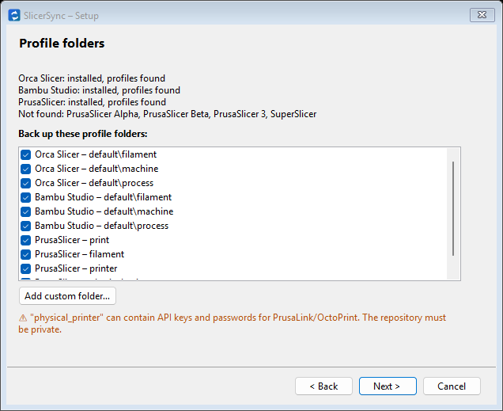
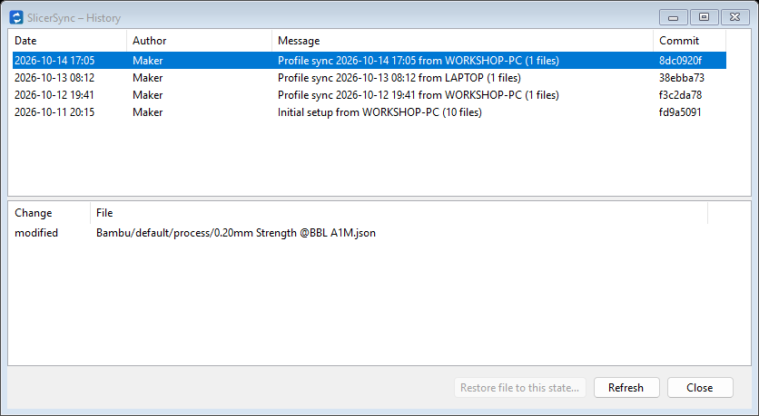
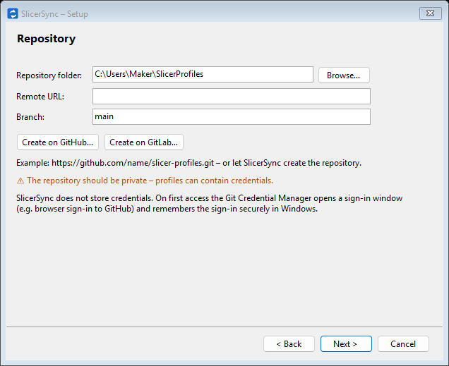
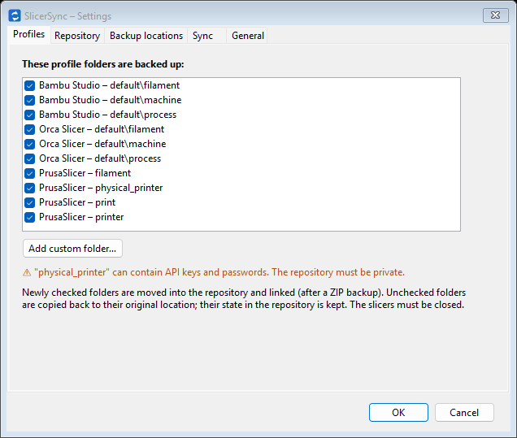
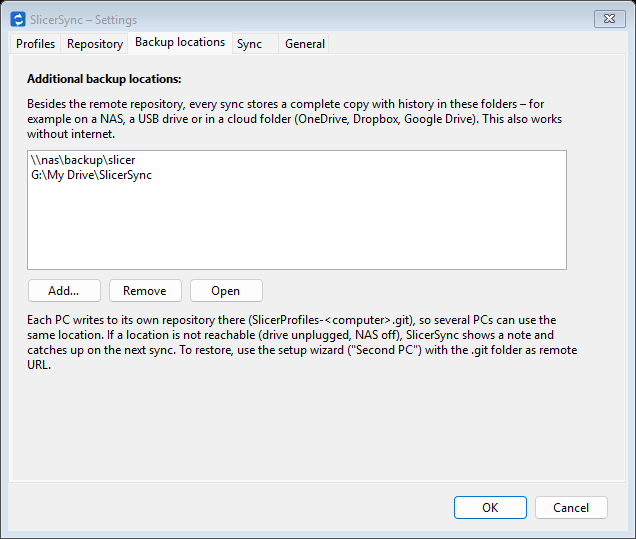
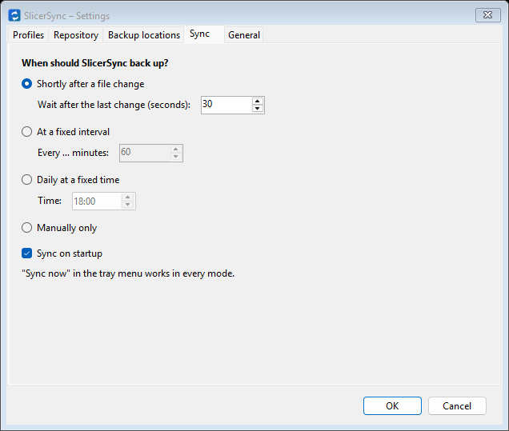

<p align="center">
  
</p>

<h1 align="center">SlicerSync</h1>

<p align="center">
  <b>Back up and sync your 3D slicer profiles with Git – automatically, with full history.</b><br>
  <b>English</b> | <a href="README.de.md">Deutsch</a>
</p>

<p align="center">
  <a href="../../releases/latest"></a>
  <a href="../../actions/workflows/ci.yml"></a>
  
  <a href="LICENSE"></a>
</p>

SlicerSync is a small Windows tray app. It backs up the printer, filament and process profiles you create in your
slicer to a **private Git repository** (GitHub, GitLab, a NAS …) and keeps them in sync between your PCs. Set it up
once with a wizard – no command line, no Git knowledge needed.

<p align="center">
  
  
</p>

## Features

- **Supported slicers:** Orca Slicer, Bambu Studio, PrusaSlicer (also 2.x alpha/beta and PrusaSlicer 3), SuperSlicer –
  plus **any other program** as a custom folder (Cura, Creality Print, ElegooSlicer, …).
- **Automatic backup** shortly after you save a profile, at an interval, daily or manually.
- **Sync between PCs:** profiles saved on one PC show up on the others.
- **Full history:** see every change and restore a single profile to an older state.
- **Extra copies** on a NAS, a USB drive or in a cloud folder (OneDrive, Dropbox, Google Drive) – also offline.
- **Creates the repository for you** on GitHub (private) or GitLab, right from the wizard.
- **Safe:** a verified ZIP backup before every change, nothing is overwritten on conflicts, undo at any time.
- **No passwords stored:** sign-in is handled by the Git Credential Manager in Windows.
- **English and German** user interface.

## Download and install

1. Download **`SlicerSync-Setup-<version>.exe`** from the [latest release](../../releases/latest).
2. Run it. If **Git for Windows** is missing, the setup downloads and installs it (checksum verified), including the
   **Git Credential Manager** for signing in to GitHub/GitLab. The .NET runtime is built into the app.
3. At the end SlicerSync starts and opens the setup wizard.

> **"Windows protected your PC"?** SlicerSync is not code-signed (certificates are expensive for a free hobby
> project), so Windows SmartScreen warns on first start. Click **More info → Run anyway**. The installer is built
> from this repository by [GitHub Actions](../../actions/workflows/release.yml).

Requirements: Windows 10 or 11 (64-bit). A portable `SlicerSync-<version>-portable.exe` is also part of each release;
it needs Git for Windows to be installed already.

## Quick start

1. **Close your slicers.**
2. In the wizard choose **New setup**, keep the detected profile folders checked and click **Create on GitHub…**
   (or GitLab, or enter the URL of an empty private repository).
3. Click **Set up**. Done – SlicerSync now runs in the notification area and backs up every change.

**On your second PC:** install SlicerSync, choose **Second PC – clone an existing repository** and enter the same
repository URL.

## How it works

1. Your profile folders are moved into a repository folder (default `%UserProfile%\SlicerProfiles`).
2. At the original location a directory junction (`mklink /J`) points to the new location. The slicers keep working
   as before; Git sees the real files.
3. A sync runs `git add -A`, commits only if something changed, then `git pull --rebase` and `git push`.

| Slicer | Original location | In the repository |
|---|---|---|
| Orca Slicer | `%AppData%\OrcaSlicer\user\<default or user ID>\{filament, machine, process}` | `Orca\…` |
| Bambu Studio | `%AppData%\BambuStudio\user\<default or user ID>\{filament, machine, process}` | `Bambu\…` |
| PrusaSlicer | `%AppData%\PrusaSlicer\{print, filament, printer, physical_printer}` | `Prusa\…` |
| PrusaSlicer 2.x alpha/beta | `%AppData%\PrusaSlicer-alpha\…` / `%AppData%\PrusaSlicer-beta\…` (same subfolders) | `PrusaAlpha\…` / `PrusaBeta\…` |
| PrusaSlicer 3 (alpha) | `%AppData%\PrusaSlicer3-dev\presets\user` | `Prusa3\presets\user` |
| SuperSlicer | `%AppData%\SuperSlicer\{print, filament, printer, physical_printer}` | `SuperSlicer\…` |
| Custom folder | any folder you choose | `Custom\<name>` |

Only these profile folders are backed up, never the whole application folder. Caches, downloaded vendor data and
machine-specific settings stay where they are.

> ⚠ **`physical_printer`** (PrusaSlicer/SuperSlicer) can contain API keys and passwords for PrusaLink/OctoPrint.
> Your repository **must be private**.

## Using it

### The setup wizard

1. **Welcome:** language selection and Git check.
2. **Setup type:** *New setup* (this PC has the profiles) or *Second PC*.
3. **Profile folders:** detected folders, plus **Add custom folder…** for any other program. Optionally pick the
   program's EXE, so SlicerSync can check that it is closed before moving files.
4. **Repository:** local folder, remote URL, branch – or **Create on GitHub…** / **Create on GitLab…**.
5. **Summary → Set up:** ZIP backup, move and link the folders, first commit and upload.

Folders that are already set up are detected and skipped, so you can run the wizard again at any time (e.g. after a
slicer update recreated a folder).

<p align="center">
  
  
</p>

### When does SlicerSync back up?

Under **Settings → Sync**: shortly after a file change (default, 30 s after the last change), at a fixed interval,
daily at a fixed time, or manually only. In every mode there is a sync on startup (to fetch changes from your other
PCs) and **Sync now** in the tray menu. A commit is only made when files actually changed.

### Tray icon

The dot on the icon shows the state: **green** OK, **yellow** syncing, **red** error or conflict, **grey** not set up.
Right-click for the menu (Sync now, History, Settings, log, folders, setup wizard, Restore, Exit); double-click opens
the History.

### History and restoring a profile

Double-click the tray icon. Select a commit and a file and click **Restore file to this state…**. The current version
is backed up as ZIP first. Restart the slicer afterwards. Deleted profiles can be brought back the same way (select
the commit in which the file was deleted). The history is kept forever; the window shows the last 200 commits.

### Additional backup locations

Under **Settings → Backup locations** add folders on a NAS (`\\nas\backup`), a USB drive or a cloud folder (OneDrive,
Dropbox, or Google Drive via *Google Drive for desktop*, e.g. `G:\My Drive\Backups`). Every sync also stores a
complete copy with history there – even without internet. Each PC writes to its own repository
(`SlicerProfiles-<computer>.git`), so several PCs can share one location. Unreachable locations only cause a note.
To restore from such a copy, run the wizard as **Second PC** with the `.git` folder as remote URL.

<p align="center">
  
  
</p>

### Orca Slicer and Bambu Studio accounts

These slicers keep separate profiles per signed-in account (folder `default` without sign-in, otherwise your user ID).
To see the same profiles on every PC, **sign in with the same account everywhere** – or sign in nowhere.

If your profiles are in an account folder but you want to work without signing in, use **Settings → Profiles → Use
account profiles without sign-in…**. It copies them into `default` (account and cloud IDs removed, replaced versions
backed up as ZIP, the account folder untouched). Then sign out in the slicer on every PC.

### Conflicts

A conflict happens when two PCs changed the same profile differently before syncing. SlicerSync then stops and
overwrites nothing; the icon turns red. To resolve it, open the repository folder in Git Bash:

```bash
cd ~/SlicerProfiles
git pull --rebase origin main     # shows the affected files
# edit the files: keep the version you want, remove the conflict markers
git add -A
git rebase --continue
git push
```

Alternatively run `git rebase --abort`, restore the file to the other PC's state via the History, and sync again.

### Restore (undo setup) and uninstall

Tray menu → **Restore (undo setup)…** removes all junctions and copies the folders back to their original location.
The repository and its history stay. Single folders can be unchecked in **Settings → Profiles**.

Uninstalling (Windows *Settings → Apps*) removes the program only; the junctions stay and the slicers keep working.
Run **Restore** first if you want the folders back in their original place.

## FAQ and troubleshooting

<details>
<summary><b>My second PC shows fewer profiles than the first one.</b></summary>

Usually Orca Slicer or Bambu Studio is signed in to an account on one PC and not on the other – see
[Orca Slicer and Bambu Studio accounts](#orca-slicer-and-bambu-studio-accounts).
</details>

<details>
<summary><b>SlicerSync does not start with Windows.</b></summary>

Check **Settings → General → Start with Windows** and *Task Manager → Startup apps* (Windows may have disabled it;
SlicerSync then shows a warning in the settings). Windows 11 also likes to hide new tray icons behind the **^** arrow.
The log (tray menu → *Open log*) says "SlicerSync started (Windows startup)" when Windows started it.
</details>

<details>
<summary><b>The icon is red: "the folder is no longer linked".</b></summary>

A slicer update or another tool replaced a profile folder. Run the setup wizard again (it relinks the folder), or
uncheck the folder in **Settings → Profiles** if you no longer want to back it up.
</details>

<details>
<summary><b>"Repository not found" / sign-in problems.</b></summary>

Check the URL in **Settings → Repository**. If the repository was deleted or renamed, create a new one (for a fresh
start: Restore, then run the wizard again). To sign in again, remove the `git:https://github.com` entry in the
Windows Credential Manager; the next sync asks for sign-in.
</details>

<details>
<summary><b>Can I use SlicerSync without GitHub or GitLab?</b></summary>

Yes. Leave the remote URL empty: you still get the local history, and with **backup locations** a copy on a NAS,
USB drive or cloud folder. You can also use a bare repository on a network share as remote URL.
</details>

<details>
<summary><b>Does SlicerSync send my data anywhere else?</b></summary>

No. Your profiles only go to the repository and backup locations you configure. SlicerSync has no server, no
telemetry and stores no passwords.
</details>

## Where things are stored

| What | Where |
|---|---|
| Settings | `%AppData%\SlicerSync\settings.json` |
| Log | `%LocalAppData%\SlicerSync\slicersync.log` |
| ZIP backups | `%LocalAppData%\SlicerSync\backups\` |
| Profiles + Git repository | default `%UserProfile%\SlicerProfiles` |

The repository also contains `slicersync.json` (the list of backed-up folders, used by a second PC) and
`.gitattributes` (files are stored byte for byte).

## Contributing

Bug reports, ideas and pull requests are welcome – in English or German. See [CONTRIBUTING.md](CONTRIBUTING.md) for
how to build, test and add support for another slicer. Changes are listed in the [changelog](CHANGELOG.md).

## License

[MIT](LICENSE)
